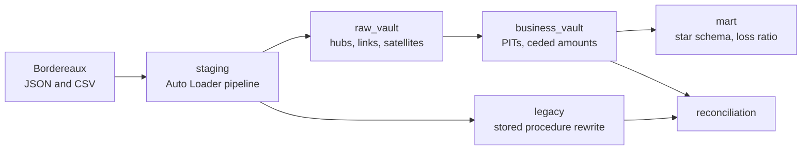

# Reinsurance Data Vault

Data Vault 2.0 platform for a reinsurer on Databricks. Monthly bordereaux from three cedents land as raw files, go through a raw vault and a business vault, and end in a star schema with loss ratios per treaty. A legacy stored procedure that computed ceded claims is rewritten in PySpark and reconciled claim by claim against the new model.

Built on Databricks Free Edition with Unity Catalog, Lakeflow Declarative Pipelines, Asset Bundles and GitHub Actions. All data is synthetic.

## Architecture

One job runs the whole flow: staging, raw_vault, business_vault, then mart and reconciliation in parallel. The same code runs in dev (`reinsurance_dev`) and prod (`reinsurance`); the catalog is a bundle variable.

## The data

`src/generator.py` writes 24 monthly bordereaux (January 2024 to December 2025) for 3 cedents and 18 treaties:

- Property treaties are excess of loss (retention 1M, limit 4M). Motor and marine are quota share, ceding 30% to 50%.
- Claims arrive in three different layouts: a CSV with Spanish column names, a JSON file with ISO dates, and a CSV with yyyymmdd dates and O/C status codes.
- The feed has the problems a real one has: a mid-year endorsement (T-CED01-MOTOR-2024 goes from 50% to 35% in July 2024), a cedent rating downgrade, rows sent twice in the same file, and a claim booked against a treaty that was never written.

The generator is deterministic, so every number below can be reproduced.

## Layers

| Layer | What it does |
|---|---|
| staging | Auto Loader reads each source incrementally and maps the three claim layouts to one table. Hash keys and hashdiffs are computed here. Data quality rules flag rows but drop nothing. |
| raw_vault | 3 hubs, 2 links, a non-historized link for premiums and 3 satellites. A metadata-driven loader builds them from one config line per table and two generic functions. Insert-only and idempotent. |
| business_vault | Monthly point-in-time tables, and the ceded amount per claim using the treaty terms in force in the month of loss. |
| mart | `dim_cedent`, `dim_treaty`, `fact_premium`, `fact_claim_month` and `loss_ratio`. |
| legacy | PySpark rewrite of the old stored procedure and its reconciliation. |

## Results

Row counts in prod, identical to dev:

| Table | Rows |
|---|---|
| hub_claim | 606 |
| hub_treaty | 19 (18 treaties plus the unknown one) |
| sat_treaty_terms | 19 (18 treaties plus the endorsement) |
| sat_claim_status | 3,718 |
| pit_claim | 7,298 |
| loss_ratio | 18 |

Running the whole job a second time changes nothing.

Ceded claims at December 2025:

| Treaty type | Claims | Gross incurred | Ceded incurred | Ceded / gross |
|---|---|---|---|---|
| Quota share | 499 | 40,557,907.23 | 17,238,008.57 | 0.425 |
| Excess of loss | 106 | 29,328,062.67 | 3,226,140.49 | 0.110 |
| No treaty | 1 | 164,444.14 | - | - |

The mart reconciles to the cent with the business vault: 69,885,969.90 gross and 20,464,149.06 ceded.

Quota share treaties show the same gross and ceded loss ratio, except T-CED01-MOTOR-2024 (0.550 gross, 0.531 ceded), where the July endorsement changes the share for part of the year. Excess of loss ceded loss ratios go from 0 to 5.13, depending on whether a large loss reached the layer.

## Legacy migration

`legacy/usp_calc_ceded_claims.sql` is a T-SQL procedure with a cursor, the kind of code these migrations start from. `src/legacy_ceded.py` rewrites it one to one in PySpark, defects included, so it produces what the old system produced. The reconciliation compares that output with the business vault claim by claim:

| Result | Claims | Gross diff | Ceded diff |
|---|---|---|---|
| match | 571 | 0.00 | 0.00 |
| endorsement applied retroactively | 29 | 0.00 | -194,348.38 |
| duplicate rows in bordereau | 5 | 822,258.58 | 284,706.64 |
| dropped by legacy: no treaty | 1 | -164,444.14 | 0.00 |
| unexplained | 0 | | |

Three defects in the procedure explain every difference:

1. It takes the latest treaty terms (`TOP 1 ... ORDER BY load_date DESC`) instead of the terms in force at the loss date, so the endorsement also hits claims that occurred before it.
2. Its `MAX(load_date)` filter keeps rows the cedent sent twice, and the cursor counts them twice.
3. `IF @@ROWCOUNT > 0` skips claims without a treaty and leaves no trace of them.

## Repository layout

## Running it

1. Run `notebooks/00_setup`, then `notebooks/01_generate_data` with the `catalog` widget set to `reinsurance_dev`.
2. `databricks bundle deploy`
3. `databricks bundle run reinsurance_monthly`

Prod is deployed by GitHub Actions on every merge to `main`.
